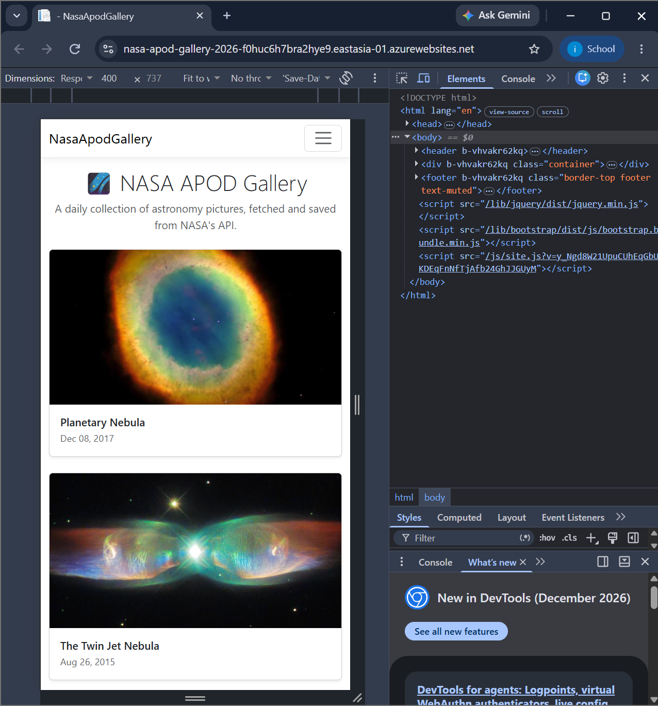
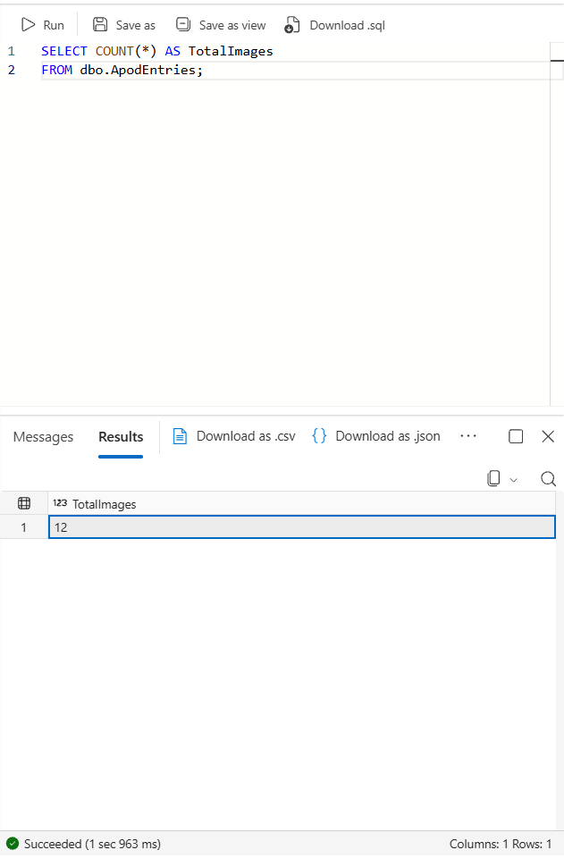

## Live Demo

🌐 **Deployed Application:** [NASA APOD Gallery](https://nasa-apod-gallery-2026-f0huc6h7bra2hye9.eastasia-01.azurewebsites.net/)

The application is deployed on Microsoft Azure and uses Azure SQL Database to store and retrieve NASA astronomy records.

## Azure Cloud Deployment

The project has been deployed using the following Microsoft Azure services:

| Azure Service | Purpose |
|---|---|
| Azure App Service | Hosts the ASP.NET Core MVC application |
| Azure SQL Database | Stores NASA APOD records |
| Azure SQL Logical Server | Manages the SQL database connection and access |
| Azure App Service Environment Variables | Stores application configuration for deployment |

### Application Workflow

1. The application sends HTTP requests to NASA's APOD API using `HttpClient`.
2. NASA returns astronomy information in JSON format.
3. The application converts the JSON response into C# DTO objects.
4. The repository saves new records to Azure SQL Database using parameterized ADO.NET queries.
5. The MVC controller retrieves saved records from the database.
6. The Razor view displays astronomy images and information in a responsive Bootstrap gallery.

### Deployment Verification

- Application successfully deployed to Azure App Service.
- Azure SQL Database configured and connected.
- Astronomy records successfully stored and retrieved.
- Database duplicate-date check completed successfully.
- Responsive gallery tested using Chrome DevTools.

## Screenshots

### NASA APOD Gallery

### Responsive Mobile View

### Azure SQL Database

*Screenshots should be added to the repository's `screenshots` folder before these image links will work.*